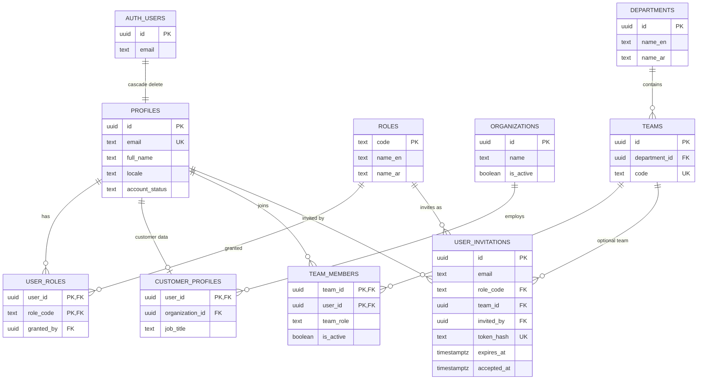
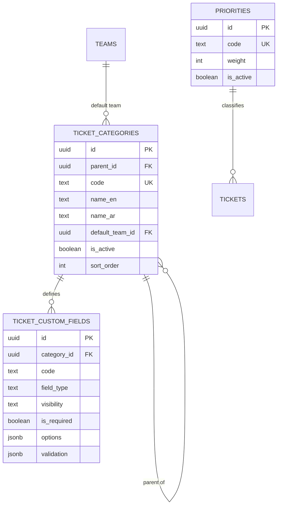
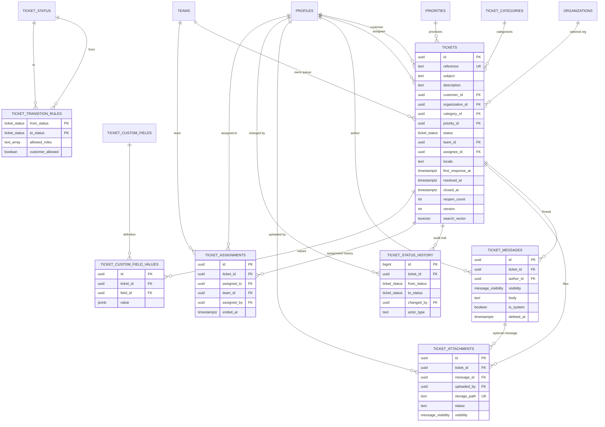
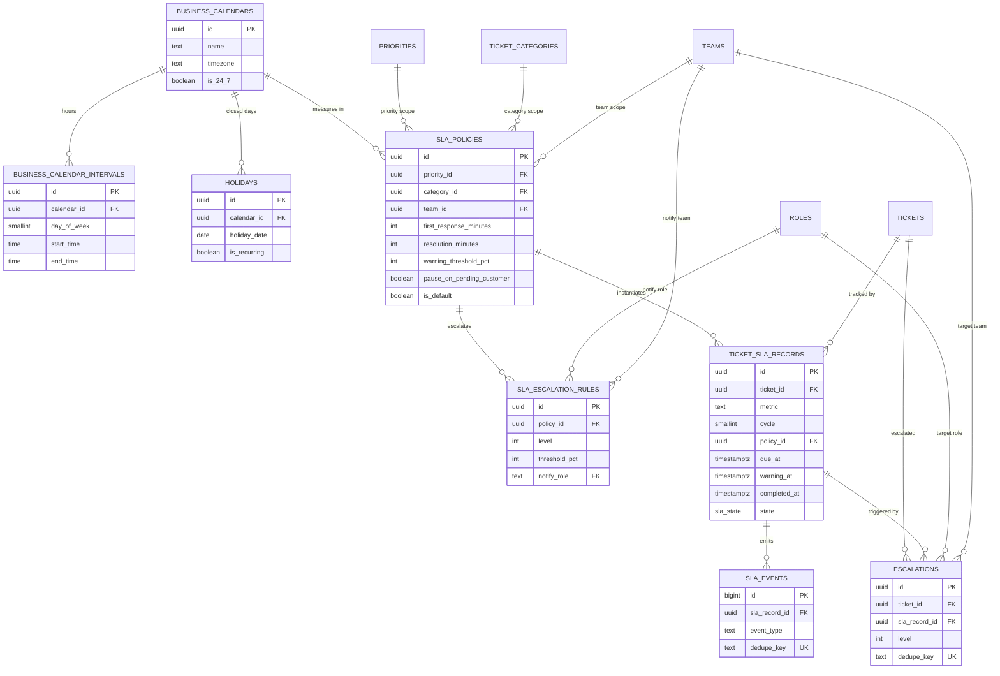
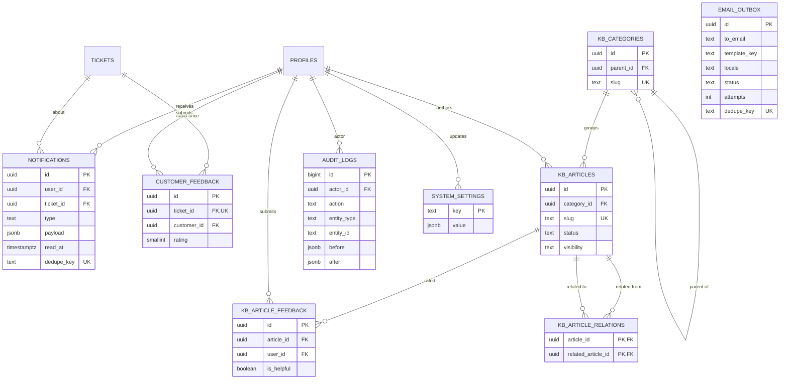

# Database Relationships

Companion to [DATABASE_SCHEMA](DATABASE_SCHEMA.md). Diagrams are split by domain
so they stay readable. Cardinality is shown as `parent ||--o{ child` (one parent
to zero-or-many children).

## 1. Identity and organization

Key rules:

- A profile exists only while its `auth.users` row exists (cascade).
- `user_roles` is many-to-many; the application domain rejects mixing
  `customer` with staff roles, but the database does not enforce it yet.
- `team_members` is many-to-many with a per-membership `leader`/`agent` role.
- Only one **pending** invitation per lowercased email (partial unique index).

## 2. Catalog

- Categories are limited to two levels by trigger.
- A custom field with `category_id = NULL` is global.
- `(category_id, code)` is unique with `NULLS NOT DISTINCT`, so a global code
  cannot be duplicated.

## 3. Ticketing core

Key rules:

- `ticket_number_counters` has no FK; it is a per-year sequence table.
- `ticket_transition_rules` references enum values, not rows; it is a lookup
  table keyed by the `(from, to)` pair.
- One current assignment per ticket: partial unique index on
  `ticket_assignments(ticket_id) where ended_at is null`.
- Deleting a ticket cascades messages, history, attachments, SLA records,
  escalations and feedback. Customer/priority/category deletes are restricted.
- `ticket_messages.author_id` and `tickets.assignee_id` become `NULL` if the
  staff profile is deleted, preserving the ticket history.
- Attachments can exist as `draft` (no ticket) and later become `linked`.

## 4. SLA

Key rules:

- A ticket has at most one record per `(metric, cycle)`.
- A policy scope is unique per `(priority, category, team)` when active, with
  `NULLS NOT DISTINCT`. Exactly one active policy can be the default.
- `ticket_sla_records.policy_id` is a plain FK with the default `NO ACTION`
  behaviour, so a policy cannot be deleted while SLA records reference it.
  This protects historical clocks.
- `sla_events.dedupe_key` and `escalations.dedupe_key` make cron retries
  idempotent.

## 5. Operations, knowledgebase and feedback

Key rules:

- `email_outbox.to_email` is an address snapshot, not an FK. It survives user
  deletion and supports invitations to people who have not signed up.
- `customer_feedback` is one row per ticket (`ticket_id` unique).
- `audit_logs` is append-only and references the actor with `on delete set null`.
- KB relations are a directed pair; the check prevents self-relations only, not
  duplicate reciprocal rows. The application must avoid creating both A→B and
  B→A unless intended.

## 6. Delete and cascade matrix

| Parent deleted | Child | Action |
| --- | --- | --- |
| `auth.users` | `profiles` | CASCADE |
| `profiles` | `user_roles`, `customer_profiles`, `team_members`, `notifications`, `kb_article_feedback`, `customer_feedback` | CASCADE |
| `profiles` | `tickets.customer_id` | RESTRICT (cannot delete a customer with tickets) |
| `profiles` | `ticket_messages.author_id`, `tickets.assignee_id`, `tickets.resolution_by`, `ticket_assignments.assigned_to`, `audit_logs.actor_id`, `kb_articles.author_id` | SET NULL |
| `profiles` | `ticket_attachments.uploaded_by` | RESTRICT |
| `tickets` | messages, attachments, history, custom values, SLA records, escalations, feedback, notifications | CASCADE |
| `ticket_messages` | `ticket_attachments.message_id` | SET NULL |
| `teams` | `tickets.team_id`, `ticket_categories.default_team_id`, `ticket_assignments.team_id`, `sla_escalation_rules.notify_team_id`, `escalations.escalated_to_team` | SET NULL |
| `teams` | `team_members`, `user_invitations.team_id`, `sla_policies.team_id` | CASCADE for members; SET NULL for invitations; CASCADE for policies |
| `departments` | `teams.department_id` | SET NULL |
| `ticket_categories` | `tickets.category_id` | RESTRICT |
| `ticket_categories` | `ticket_custom_fields.category_id`, `sla_policies.category_id` | CASCADE |
| `ticket_categories` (parent) | `ticket_categories.parent_id` | RESTRICT |
| `priorities` | `tickets.priority_id` | RESTRICT |
| `priorities` | `sla_policies.priority_id` | CASCADE |
| `ticket_custom_fields` | `ticket_custom_field_values.field_id` | CASCADE |
| `business_calendars` | intervals, holidays | CASCADE |
| `business_calendars` | `sla_policies.business_calendar_id` | RESTRICT |
| `sla_policies` | `sla_escalation_rules`, `ticket_sla_records` | CASCADE / RESTRICT (records block deletion) |
| `ticket_sla_records` | `sla_events` | CASCADE |
| `ticket_sla_records` | `escalations.sla_record_id` | SET NULL |
| `kb_articles` | feedback, relations | CASCADE |
| `kb_categories` (parent) | child categories | RESTRICT |

> The SLA policy → ticket record relationship is deliberately protective:
> historical SLA clocks must not disappear when a policy is retired. Retire by
> setting `is_active = false`, never by deleting.

## 7. Referential integrity rules that need application logic

The database cannot express every business rule. These require RPC/service
validation and tests:

1. A ticket's `assignee_id` must be an active member of `team_id` (or a leader).
2. A resolution transition requires `resolution_summary` and sets
   `resolved_at`, `resolution_by`.
3. Closing requires either customer confirmation or an auto-close job.
4. `reopen_count` must not exceed `max_reopens`; reopen requires the window.
5. `ticket_status_history` must be written for every status change.
6. `ticket_custom_field_values` must satisfy the field's `is_required`,
   `field_type` and `validation`.
7. An attachment must belong to the same ticket as its message.
8. A customer must not read an internal message through any join, view or RPC.
9. Only one current assignment, already enforced by the partial index.
10. SLA policy selection must pick the most specific active policy and snapshot
    its targets.

These are listed in [TEST_PLAN](TEST_PLAN.md) and [BACKLOG](BACKLOG.md).
