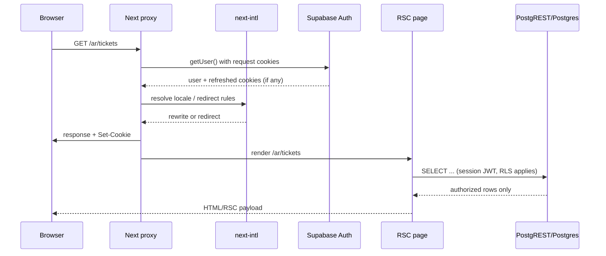
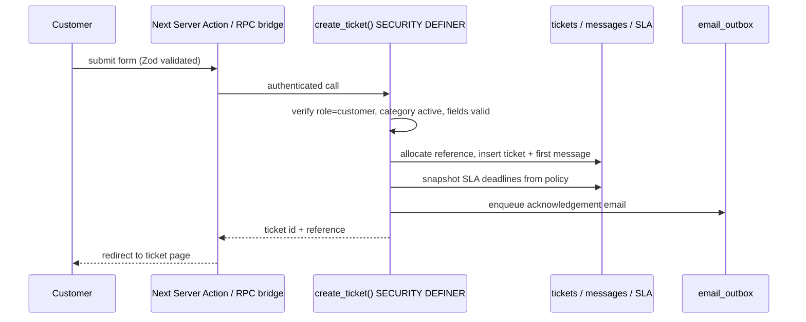

# System Architecture

> Scope: Phase 1 foundation. Describes what exists today and the target shape
> for later phases. Items marked **(planned)** are not implemented yet.

## 1. Goals and constraints

- Bilingual customer support: English and Arabic, full RTL, localized dates.
- Two audiences: external customers and internal support staff.
- Strong database authorization: PostgreSQL Row Level Security (RLS) is the
  read boundary; no client is trusted to filter data.
- Serverless-friendly: no long-lived application server, no in-process cron.
- Forward-only migrations that can be promoted from staging to production.
- Future migration to .NET / Angular / SQL Server without changing the domain
  vocabulary (see [MIGRATION_READINESS](MIGRATION_READINESS.md)).
- No ORM. Explicit SQL keeps RLS, constraints and transaction boundaries visible.

## 2. Logical components

```mermaid
flowchart TB
  subgraph Browser
    U[Customer or staff browser]
    LS[Locale switcher]
  end

  subgraph Vercel["Vercel (Next.js 16)"]
    PX[src/proxy.ts<br/>locale routing + session refresh]
    RSC[React Server Components<br/>/[locale]/...]
    RH[Route Handlers<br/>/api/health, /auth/callback]
    CRON[Cron route<br/>planned]
    LOG[Pino logger]
  end

  subgraph Supabase
    AUTH[Supabase Auth<br/>GoTrue]
    API[PostgREST]
    DB[(PostgreSQL 17<br/>tables + RLS + RPCs)]
    ST[(Storage<br/>private attachments)]
    OUT[(email_outbox)]
  end

  MAIL[Resend<br/>planned]

  U -->|HTTPS| PX
  LS --> U
  PX --> RSC
  PX -->|refresh cookies| AUTH
  RSC -->|"SELECT (RLS)"| API
  RH -->|health RPC| API
  CRON -->|service role| API
  API --> DB
  U -->|direct upload/download<br/>planned| ST
  DB --> OUT
  CRON --> OUT
  OUT --> MAIL
  RSC --> LOG
  RH --> LOG
  CRON --> LOG
```

### Component responsibilities

| Component | Responsibility | Key files |
| --- | --- | --- |
| Proxy | Locale negotiation/redirect and Supabase session cookie rotation before render | `src/proxy.ts`, `src/lib/supabase/proxy.ts` |
| Localized layout | `<html lang dir>`, fonts, metadata, `NextIntlClientProvider`, skip link | `src/app/[locale]/layout.tsx` |
| Pages | Server-rendered UI; read data through the request-scoped Supabase client | `src/app/[locale]/**` |
| Route handlers | Health check and auth callback; later attachment downloads, cron, webhooks | `src/app/api/**`, `src/app/auth/**` |
| Domain modules | Pure rules shared by UI and tests: statuses, transitions, reopen policy, permissions, reference format | `src/domain/**` |
| Supabase clients | Browser session client, server session client, privileged client | `src/lib/supabase/**` |
| Database | Schema, constraints, indexes, RLS, RPCs, seeds | `supabase/migrations/**` |
| Outbox | Durable email queue consumed by a cron dispatcher **(planned)** | `public.email_outbox` |
| CI | Typecheck, lint, unit tests, build, clean-database migration reset | `.github/workflows/ci.yml` |

## 3. Request flows

### 3.1 Page request



Rules:

- Proxy calls `auth.getUser()` (validates the token with Auth), never
  `getSession()` alone.
- Refreshed cookies are attached to the outgoing proxy response, so both the
  browser and the server render see the rotated session.
- Proxy matches pages only; `/api`, `/auth`, `_next`, `_vercel` and files with
  an extension bypass it.
- RLS still runs on every query. Proxy is not an authorization layer.

### 3.2 Health check

`GET /api/health` calls the `public.health()` RPC with the anon key.

| Condition | HTTP | Body `status` |
| --- | --- | --- |
| Supabase env missing | 503 | `unconfigured` |
| RPC non-2xx | 503 | `error` |
| Network failure | 503 | `error` |
| RPC succeeds | 200 | `ok` |

The endpoint is intentionally safe to expose: it returns no secrets, row data
or stack traces. It will be extended in later phases with migration version and
outbox backlog checks.

### 3.3 Ticket creation (planned)



Ticket creation, message posting and status changes must be **single
transactions**. The reference allocator is already written so two concurrent
calls cannot receive the same sequence.

## 4. Trust boundaries

| Boundary | Trusted? | Controls |
| --- | --- | --- |
| Browser input | No | Zod on the server; DB constraints; RPC validation |
| Browser Supabase client | No | Anon key only; RLS; `SELECT` grants |
| Next server session client | Partly | User JWT; RLS; server-only import guard |
| Service-role client | Yes, restricted | `server-only`; cron/webhook/signing only; no client import |
| Database | Authority | Constraints, triggers, RLS, `SECURITY DEFINER` search-path pinning |
| Email provider webhooks | No | Signature verification **(planned)** |
| Attachment storage | No | Private bucket; authorization before signed URL **(route planned)** |

### Why writes are RPC-centric

Allowing direct `INSERT`/`UPDATE` grants would make invariants optional. For
example, a client could set `status='resolved'` without a resolution summary,
skip the transition rules, or update `assignee_id` without an assignment
history row. `SECURITY DEFINER` RPCs keep those invariants in one transaction.

Every definer function must:

1. Declare `set search_path = ''` and schema-qualify every object.
2. Resolve the actor with `auth.uid()`; never accept an actor id from the client.
3. Re-check role and ticket ownership/team scope.
4. Validate the transition against `ticket_transition_rules`.
5. Write status history, audit log and outbox rows in the same transaction.
6. Be revoked from `public` and granted only to the intended role.

## 5. Data architecture

- 37 public tables across identity, catalog, ticketing, SLA, operations,
  knowledgebase and feedback.
- Enums: `ticket_status`, `message_visibility`, `sla_state`.
- Ticket references: `CTS-YYYY-NNNNNN`, allocated by
  `private.allocate_ticket_reference(year)` under a row lock. Gaps are allowed
  on rollback.
- SLA deadlines are precomputed at clock start (`due_at`, `warning_at`) so list
  queries do not recompute business hours per row. `private.add_business_minutes`
  handles closed days, holidays and split intervals.
- Messages are a single table with `visibility = public | internal`; internal
  rows are filtered by RLS for customers.
- `audit_logs` is append-only (trigger rejects UPDATE/DELETE).
- `email_outbox` is a durable queue with `dedupe_key`, attempts and retry time.
  It has RLS enabled and **no policies/grants**: only the service role can use it.

Full details: [DATABASE_SCHEMA](DATABASE_SCHEMA.md),
[DATABASE_RELATIONSHIPS](DATABASE_RELATIONSHIPS.md),
[DATA_DICTIONARY](DATA_DICTIONARY.md).

## 6. Internationalization

- `next-intl` with `localePrefix: 'always'`; `/` redirects to `/en` or `/ar`.
- Arabic sets `<html lang="ar" dir="rtl">`; layout uses logical CSS properties
  (`ms-*`, `me-*`, `start-*`, `end-*`) so direction flips automatically.
- Fonts: Inter (Latin) and IBM Plex Sans Arabic, loaded through `next/font`.
- Time zone: `Asia/Riyadh` in the request config. Dates and numbers must be
  formatted with `next-intl` formatters, never with hardcoded English formats.
- Database stores bilingual reference data in `name_en` / `name_ar` columns and
  customer content in whichever language the customer used.
- UI strings live in `messages/en.json` and `messages/ar.json`. Missing keys
  fail the build/render loudly (as intended).

## 7. Observability

- **Pino** JSON logs, server only, with redaction for authorization headers,
  cookies, passwords, tokens, email, phone, message bodies.
- `LOG_LEVEL` controls verbosity; default `info`.
- Health endpoint for uptime checks.
- Vercel provides build/runtime logs and function metrics.
- Database observability: Supabase logs, `pg_stat_statements` (recommended in
  production), slow-query review, and outbox backlog monitoring **(planned)**.
- No third-party analytics or tracking scripts are included.

## 8. Background processing

SLA evaluation and email dispatch cannot run inside a request. Two supported
deployment options:

| Option | Requirement | Notes |
| --- | --- | --- |
| Vercel Cron | Pro plan for sub-daily schedules | Hobby allows only daily cron. A 5-minute SLA loop is not possible on Hobby. |
| Supabase `pg_cron` + Edge Function | Available on Supabase | Runs inside the Supabase project; does not depend on Vercel plan. |

The target is a `GET /api/cron/sla` and `GET /api/cron/email` protected by
`CRON_SECRET`, idempotent, with `dedupe_key` guards. **Neither route exists
yet**, so no cron should be configured in B6 until Phase 5 lands.

## 9. Deployment topology

```text
Developer ──push──> GitHub (main / develop)
                       │
                       ├── CI: typecheck, lint, test, build, db reset
                       │
                       ├── Vercel Preview  ──> Supabase project (shared)
                       └── Vercel Production ──> Supabase project (shared)
```

- **Current plan: one Supabase project** shared by Preview and Production
  while the product is being built. Do not store real customer data until a
  separate staging project exists.
- Environment variables are scoped per Vercel environment.
- Migrations are applied with `supabase db push` or the `migrations.yml`
  workflow (single `production` environment for now).
- Domain and email DNS are configured at the owner's registrar/provider. See
  [DEPLOYMENT_GUIDE](DEPLOYMENT_GUIDE.md).

## 10. Failure modes and mitigations

| Failure | Effect | Mitigation |
| --- | --- | --- |
| Supabase env missing | Health 503; auth unavailable; landing still renders | Fail-fast env validation in server paths; deployment checklist |
| Auth service down | Users cannot sign in; existing sessions may still read until expiry | Status page; retry; no local credential store |
| Database down | All data routes fail | Health check, Vercel alerts, Supabase backups/PITR |
| Proxy misconfiguration | Redirect loops or locale not applied | Matcher excludes API/auth/assets; E2E locale test |
| RLS policy regression | Data leak or empty lists | RLS tests with multiple identities; review checklist |
| Duplicate cron execution | Duplicate emails/escalations | Unique `dedupe_key`; idempotent handlers |
| Outbox backlog | Delayed notifications | Backlog metric + alert; retry with capped attempts |
| Migration failure | Deploy blocked | Test on clean DB in CI; forward-fix migration; backup before prod |

## 11. Architectural decisions

| Decision | Rationale |
| --- | --- |
| Modular monolith, not microservices | Small team, shared transactional invariants, lower operational cost |
| Supabase instead of custom auth | Managed Auth, RLS-native JWT, Storage, lower build cost |
| RPC-centric writes | Enforce invariants and audit in one transaction |
| RLS-centric reads | Defense in depth; no accidental over-fetch |
| Precomputed SLA timestamps | Fast queue sorting and filtering |
| Transactional outbox | No lost emails on provider outage; retries survive restarts |
| No React Query | Server Components + route handlers cover Phase 1; avoids duplicate cache |
| Forward-only migrations | Predictable promotion; rollback by restore/forward fix |
| TypeScript 5.9.3 | Tooling compatibility; TypeScript 7 is not yet supported by all plugins |
| ESLint 10 | Avoids deprecated 9.x line; transitive plugins still declare ≤9 peer ranges (see known issues) |

## 12. Future migration architecture

The domain vocabulary (statuses, roles, transitions, SLA states) is already
isolated in `src/domain` and in database lookup tables. A future .NET API can
reuse it while replacing:

- Supabase Auth → ASP.NET Core Identity / Entra ID / OIDC
- PostgREST + RLS → application authorization plus SQL Server Row-Level Security
- Supabase Storage → Azure Blob Storage or S3
- Vercel Cron → Hangfire / Azure Functions / Worker Service
- `jsonb` → `nvarchar(max)` with JSON validation
- `text[]` → join tables
- `tsvector` → SQL Server full-text indexes

See [MIGRATION_READINESS](MIGRATION_READINESS.md). No migration work has started.
