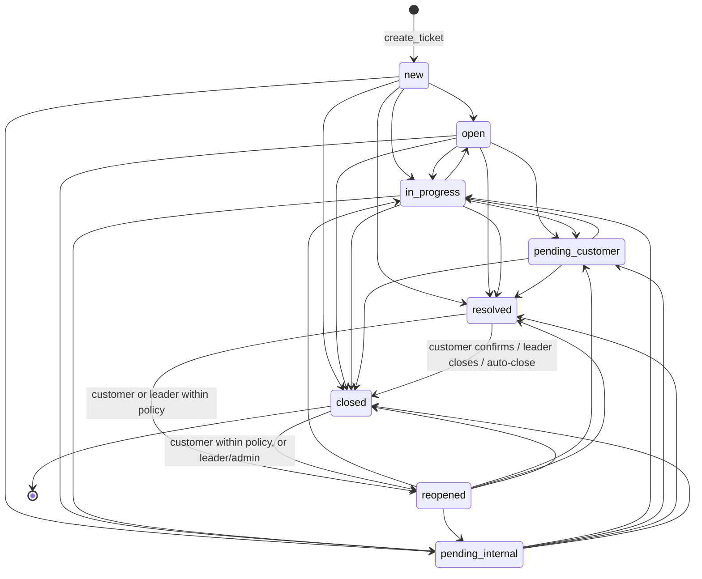

# Ticket Workflow

> The rules below match `public.ticket_transition_rules` seeded in
> `0010_seed_reference_data.sql` and the TypeScript mirror in
> `src/domain/ticket-status.ts`. The database is the authority; the TypeScript
> copy drives UI affordances and unit tests. Any change must update both, plus
> a migration for existing environments.

## 1. Statuses

| Status | Meaning | Customer-visible state | SLA clock |
| --- | --- | --- | --- |
| `new` | Created, not yet triaged | "Submitted" | Running |
| `open` | Accepted into a queue, not yet actively worked | "Open" | Running |
| `in_progress` | Assigned/being worked | "In progress" | Running |
| `pending_customer` | Waiting for the customer's answer | "Waiting for you" | **Paused** (approved default) |
| `pending_internal` | Waiting on an internal dependency | "In progress" | Running by default |
| `resolved` | Solution provided, awaiting confirmation or auto-close | "Resolved" | Resolution clock completed |
| `closed` | Confirmed or auto-closed; no active work | "Closed" | Completed |
| `reopened` | Customer (or leader/admin) reopened after resolution/closure | "Reopened" | New cycle starts |

The customer-facing wording should be localized; do not expose internal terms
such as `pending_internal` in the portal.

## 2. State diagram

## 3. Transition rules (30)

`customer_allowed` is a hint for the portal; the RPC must still check both
`allowed_roles` and the customer-specific policy. `requires_reason` means the
RPC rejects the call without a non-empty reason (resolution summary or reopen
reason).

| # | From | To | Allowed roles | Customer allowed | Reason required |
| ---: | --- | --- | --- | :---: | :---: |
| 1 | `new` | `open` | support_agent, team_leader, system_admin | No | No |
| 2 | `new` | `in_progress` | support_agent, team_leader, system_admin | No | No |
| 3 | `new` | `pending_internal` | support_agent, team_leader, system_admin | No | No |
| 4 | `new` | `resolved` | support_agent, team_leader, system_admin | No | Yes |
| 5 | `new` | `closed` | team_leader, system_admin | No | Yes |
| 6 | `open` | `in_progress` | support_agent, team_leader, system_admin | No | No |
| 7 | `open` | `pending_customer` | support_agent, team_leader, system_admin | No | No |
| 8 | `open` | `pending_internal` | support_agent, team_leader, system_admin | No | No |
| 9 | `open` | `resolved` | support_agent, team_leader, system_admin | No | Yes |
| 10 | `open` | `closed` | team_leader, system_admin | No | Yes |
| 11 | `in_progress` | `open` | support_agent, team_leader, system_admin | No | No |
| 12 | `in_progress` | `pending_customer` | support_agent, team_leader, system_admin | No | No |
| 13 | `in_progress` | `pending_internal` | support_agent, team_leader, system_admin | No | No |
| 14 | `in_progress` | `resolved` | support_agent, team_leader, system_admin | No | Yes |
| 15 | `in_progress` | `closed` | team_leader, system_admin | No | Yes |
| 16 | `pending_customer` | `in_progress` | support_agent, team_leader, system_admin | No | No |
| 17 | `pending_customer` | `resolved` | support_agent, team_leader, system_admin | No | Yes |
| 18 | `pending_customer` | `closed` | team_leader, system_admin | No | Yes |
| 19 | `pending_internal` | `in_progress` | support_agent, team_leader, system_admin | No | No |
| 20 | `pending_internal` | `pending_customer` | support_agent, team_leader, system_admin | No | No |
| 21 | `pending_internal` | `resolved` | support_agent, team_leader, system_admin | No | Yes |
| 22 | `pending_internal` | `closed` | team_leader, system_admin | No | Yes |
| 23 | `resolved` | `closed` | customer, team_leader, system_admin | Yes | No |
| 24 | `resolved` | `reopened` | customer, team_leader, system_admin | Yes | Yes |
| 25 | `closed` | `reopened` | customer, team_leader, system_admin | Yes | Yes |
| 26 | `reopened` | `in_progress` | support_agent, team_leader, system_admin | No | No |
| 27 | `reopened` | `pending_customer` | support_agent, team_leader, system_admin | No | No |
| 28 | `reopened` | `pending_internal` | support_agent, team_leader, system_admin | No | No |
| 29 | `reopened` | `resolved` | support_agent, team_leader, system_admin | No | Yes |
| 30 | `reopened` | `closed` | team_leader, system_admin | No | Yes |

Rules that are **not** in the table and therefore rejected:

- `new → open` by a customer.
- Any transition to the same status.
- `resolved → in_progress` (reopen first; preserves the audit trail).
- `closed → resolved` (must reopen, then resolve).
- `closed → in_progress` by an agent (reopen first).
- Any status change by `management_viewer`.

## 4. Creation transaction (target behaviour, planned)

`create_ticket` must do all of the following atomically:

1. Authenticate and confirm `account_status='active'` and role `customer`.
2. Validate active category (and subcategory belongs to the category) and that
   all required custom fields are supplied and valid.
3. Assign priority server-side from the category/team triage rule. The customer
   cannot choose priority.
4. Allocate the reference with `private.allocate_ticket_reference(year)`.
5. Insert `tickets` with `status='new'`, `locale` from the request, `version=1`.
6. Insert `ticket_messages` row (`visibility='public'`, `is_system=false`) for
   the description.
7. Resolve the SLA policy, compute `due_at`/`warning_at` with
   `private.add_business_minutes`, and insert one record per metric.
8. Insert `ticket_status_history` (`from_status=NULL`, `to_status='new'`).
9. Insert `audit_logs` and `email_outbox` acknowledgement rows.
10. Return `id` and `reference`.

Failure at any step rolls back everything, including the counter increment.
Reference gaps are acceptable.

## 5. Replying

| Actor | Visibility | Effects |
| --- | --- | --- |
| Customer | `public` | Allowed only on own ticket; rejects if status is `closed`; moves `pending_customer → in_progress`; resumes paused SLA; updates `last_public_message_at`; enqueues staff notification. |
| Staff | `public` | Allowed if ticket is visible; sets `first_response_at` on the first public staff reply and completes the first-response clock; updates `last_public_message_at`; enqueues customer email. |
| Staff | `internal` | Never visible to customers; no email; does not count as first response. |
| System | `public`/`internal` | `is_system=true`; author may be null; no notification unless explicitly enqueued. |

Messages are append-only except for `edited_at`/`deleted_at`. Editing must be
restricted to the author within a short window (to be decided in Phase 3) and
must write an audit entry. Internal notes on a ticket must never be copied into
a customer email payload.

## 6. Resolution

A resolve action performs:

1. Check the transition and required role.
2. Require a non-empty `resolution_summary` (stored on the ticket and as a
   public system message).
3. Set `status='resolved'`, `resolved_at=now()`, `resolution_by=auth.uid()`.
4. Complete the resolution SLA record (`completed_at`, `state='completed'`).
5. Insert status history (`requires_reason=true`), audit, and customer email.
6. Start the auto-close timer (3 business days) and the customer reopen window
   (7 calendar days).

The customer sees a **Confirm resolution** action and a **Reopen** action. A
ticket cannot be resolved without a summary, even if an agent has permission.

## 7. Customer confirmation and closure

- `confirm_resolution` sets `customer_confirmed_at=now()`, changes
  `resolved → closed`, sets `closed_at`, writes history as the customer, and
  makes the ticket permanently non-reopenable by the customer.
- A team leader/admin may close directly from `resolved` (e.g. confirmed by
  phone). The confirmation timestamp should be set when confirmation was
  genuine; otherwise the customer could reopen within the window.
- Auto-close: a scheduled job closes `resolved` tickets after **3 business
  days** without activity. It writes history with `actor_type='system'`,
  `changed_by=NULL`, and does **not** set `customer_confirmed_at`. The customer
  may still reopen within the 7-day window (subject to limits).
- The auto-close job is not implemented. It must use the Riyadh calendar, be
  idempotent, and skip tickets with an open customer question.

## 8. Customer reopen policy

All of the following must be true:

| Condition | Value |
| --- | --- |
| Current status | `resolved` or `closed` |
| Time since `resolved_at` | ≤ **7 calendar days** |
| `reopen_count` | < **2** |
| `customer_confirmed_at` | `NULL` |
| Actor | Ticket owner, or team leader/admin (staff path) |

On reopen:

1. Increment `reopen_count`, set `reopened_at`, clear `resolved_at`,
   `closed_at`, `resolution_summary`? **No** — keep the resolution summary for
   history, but mark the current cycle as reopened.
2. Start a new SLA cycle (`cycle = reopen_count + 1`) for both metrics.
3. Write status history with the customer's reason (required).
4. Enqueue notifications and audit.
5. Status becomes `reopened`; an agent must move it to `in_progress` (or another
   working state).

The TypeScript helper `getCustomerReopenEligibility()` implements the same
conditions and returns a reason code:
`ok`, `not_resolved`, `already_confirmed`, `window_expired`,
`max_reopens_reached`. Unit tests cover these paths.

## 9. SLA interaction by status

| Transition | SLA effect |
| --- | --- |
| `any → pending_customer` | Pause both open clocks when policy `pause_on_pending_customer` is true |
| `pending_customer → in_progress` | Resume; shift `due_at`/`warning_at` by paused duration |
| `any → resolved` | Complete the resolution clock; first-response clock must already be complete or is marked breached |
| `resolved → reopened` | Close the old cycle; create a new cycle with fresh deadlines from the current policy |
| `any → closed` | Complete/stop both clocks; no further breaches |
| `pending_internal` | Does not pause by default; if the policy says pause, apply the same logic |

Pausing is based on **time spent in the status**, not on a client request. The
evaluator must be idempotent and must not double-shift deadlines on retries.

## 10. Priority changes

- Customers cannot set or change priority.
- Staff with `ticket.priority.change` may change it.
- A priority change recalculates **only future** deadlines? The approved design
  is to snapshot the policy at clock start and **not** rewrite historical
  targets. If the new priority has a different policy, the next SLA cycle uses
  it; the current cycle keeps its original target. Write an audit entry.
- The policy selection function is not implemented yet; document the chosen
  behaviour before enabling priority changes in the UI.

## 11. Assignment

- Claim: an agent assigns the ticket to themselves; a current assignment row is
  created and the previous one is ended.
- Assign/reassign: team leader/admin only; the target must be an active member
  of the ticket's team.
- Changing `team_id` ends the current assignment and requires a new one.
- The partial unique index guarantees one current assignment per ticket.
- Assignment changes do not alter SLA deadlines (except a claim may count as
  first response only when a public reply is also sent — never automatically).

## 12. Attachment rules

- Max 5 attachments per message (setting), 25 MiB each, allow-listed MIME types.
- Upload creates a `draft` row owned by the uploader. Sending the message links
  the draft (`status='linked'`, `ticket_id`, `message_id`) in the same
  transaction.
- A customer cannot attach an internal-visibility file.
- Downloads require an authorization check and a short-lived signed URL; the
  bucket is private.
- Executable/script MIME types are rejected by the bucket policy even if a
  crafted `Content-Type` is sent.

## 13. Audit and notifications

Every transition must write:

- `ticket_status_history` (customer-visible or not);
- `audit_logs` with before/after snapshots, actor, request id;
- notifications for the affected customer/assignee;
- `email_outbox` rows for customer-visible events, using `dedupe_key` such as
  `ticket:{id}:status:{history_id}`.

The outbox dispatcher must be idempotent. A duplicate cron invocation must not
send a second email.

## 14. Error codes (planned)

| Code | HTTP | Meaning |
| --- | --- | --- |
| `AUTH_REQUIRED` | 401 | No session |
| `ACCOUNT_INACTIVE` | 403 | Suspended/disabled profile |
| `FORBIDDEN` | 403 | Role/ownership check failed |
| `INVALID_TRANSITION` | 409 | Pair not in transition rules |
| `TRANSITION_FORBIDDEN` | 403 | Pair exists but role not allowed |
| `REASON_REQUIRED` | 422 | Missing summary/reason |
| `TICKET_VERSION_CONFLICT` | 409 | Optimistic concurrency failure |
| `REOPEN_WINDOW_EXPIRED` | 409 | Past 7 days |
| `REOPEN_LIMIT_REACHED` | 409 | Already reopened twice |
| `ALREADY_CONFIRMED` | 409 | Customer confirmed; cannot reopen |
| `VALIDATION_ERROR` | 422 | Field/custom-field validation |
| `ATTACHMENT_TOO_LARGE` | 413 | > 25 MiB |
| `ATTACHMENT_TYPE_NOT_ALLOWED` | 415 | MIME not allow-listed |

These codes are a contract proposal; they are not implemented by any route yet.
